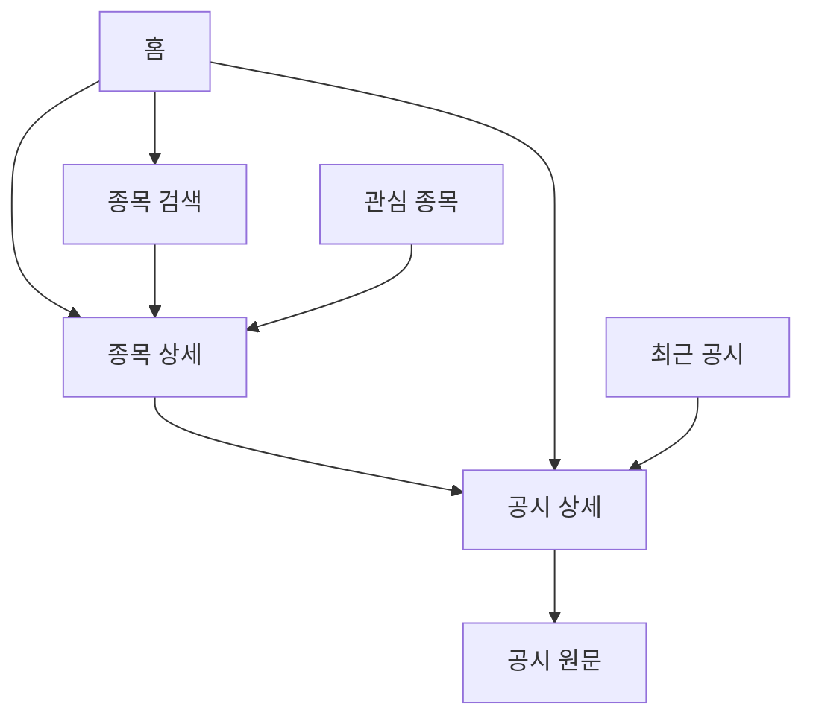

# StockTrace 안드로이드 앱 개발 기획서

## 1. 프로젝트 기본 정보

| 항목 | 내용 |
|---|---|
| 프로젝트명 | StockTrace |
| 앱 이름 | StockTrace (가칭) |
| 팀명 / 개인 | 개인 프로젝트 |
| 팀원 | 1명 |
| 개발자 | 박민석 |
| 개발 예정 기간 | 2026년 11월 25일 ~ 12월 20일 (개발 완료 목표) |
| 개발 플랫폼 | Android |
| 개발 환경 | Android Studio / Kotlin / Jetpack Compose |
| 주요 기술 | Compose 사용 중. Navigation, ViewModel, Retrofit, Room, Firebase Authentication, Cloud Firestore 도입 예정 |

### 1.1 프로젝트 한 줄 소개

- 앱 소개 — 국내 상장기업의 종목 가격과 임원·주요주주의 보유 수량 변동 공시를 함께 조회하는 Android 앱이다.
- 핵심 가치 — 관심 있는 종목에서 누가 얼마만큼의 수량 변동을 신고했는지 확인하고, 해당 공시 원문을 바로 열 수 있다.

---

## 2. 앱 개발 주제 선정 및 배경

### 2.1 개발 주제

어떤 앱을 개발할 것인지 구체적으로 설명하시오.

- 앱 개발 주제:
- 앱의 주요 분야: (예: 생활, 교육, 건강, 금융, 여행, 쇼핑, 커뮤니티, 생산성 등)
- 주제 선정 이유:

### 2.2 문제점 및 개발 필요성

현재 해당 분야에서 사용자가 겪고 있는 불편함이나 해결해야 할 문제를 작성하시오.

| 구분 | 내용 |
|---|---|
| 현재의 문제점 | |
| 기존 서비스의 불편한 점 | |
| 해결하고자 하는 문제 | |
| 앱 개발의 필요성 | |

### 2.3 개발 목표

본 앱을 개발하여 달성하고자 하는 목표를 3가지 이상 작성하시오.

1.
2.
3.

---

## 3. 사용자 분석 및 서비스 정의

### 3.1 주요 사용자

이 앱을 주로 사용할 대상은 누구인가?

- 주요 사용자:
- 사용자의 특징:
- 예상 사용자 연령 또는 유형:
- 주요 사용 상황:

### 3.2 사용자 요구사항

사용자가 앱을 통해 수행하고자 하는 작업이나 원하는 기능을 작성하시오.

| 번호 | 사용자 요구사항 | 중요도 |
|---|---|---|
| 1 | | 상 / 중 / 하 |
| 2 | | 상 / 중 / 하 |
| 3 | | 상 / 중 / 하 |
| 4 | | 상 / 중 / 하 |
| 5 | | 상 / 중 / 하 |

### 3.3 핵심 서비스 시나리오

사용자가 앱을 실행한 후 주요 기능을 이용하는 과정을 순서대로 설명하시오.

예시: 앱 실행 → 메인 화면 → 일정 등록 → 일정 목록 확인 → 일정 수정 또는 삭제

1.
2.
3.
4.
5.

---

## 4. 앱 주요 기능 설계

앱에서 제공할 기능을 구체적으로 정의하시오. 단순히 기능 이름만 작성하지 말고, 사용자가 어떤 작업을 수행하며 앱이 어떻게 반응하는지 설명해야 한다.

### 4.1 주요 기능 목록

| 번호 | 기능명 | 기능 설명 | 중요도 |
|---|---|---|---|
| 1 | | | 필수 / 선택 |
| 2 | | | 필수 / 선택 |
| 3 | | | 필수 / 선택 |
| 4 | | | 필수 / 선택 |
| 5 | | | 필수 / 선택 |
| 6 | | | 필수 / 선택 |

### 4.2 기능별 상세 설계

**기능 1. ____________________**

- 기능 목적:
- 사용자 입력:
- 처리 과정:
- 처리 결과:
- 예외 상황 또는 오류 처리:

**기능 2. ____________________**

- 기능 목적:
- 사용자 입력:
- 처리 과정:
- 처리 결과:
- 예외 상황 또는 오류 처리:

**기능 3. ____________________**

- 기능 목적:
- 사용자 입력:
- 처리 과정:
- 처리 결과:
- 예외 상황 또는 오류 처리:

※ 핵심 기능을 중심으로 추가 작성할 것.

### 4.3 데이터 관리 기능

앱에서 데이터를 어떻게 관리할 것인지 작성하시오.

| 데이터 종류 | 데이터 항목 | 저장 및 관리 방법 |
|---|---|---|
| 예: 사용자 정보 | 이름, 이메일 | |
| 예: 게시글 정보 | 제목, 내용, 작성일 | |
| 예: 설정 정보 | 알림 설정, 테마 | |

- 데이터 저장 방법: (Room / SharedPreferences / Firebase / 기타)
- 데이터 추가 기능:
- 데이터 조회 기능:
- 데이터 수정 기능:
- 데이터 삭제 기능:

---

## 5. 화면 구성 및 UI 디자인

앱에서 제공할 전체 화면을 정의하고, 각 화면의 구성 요소와 기능을 설계하시오.

### 5.1 전체 화면 구성

| 화면 번호 | 화면명 | 주요 목적 | 주요 UI 요소 |
|---|---|---|---|
| 1 | 홈 | 종목 가격을 살펴보고 탐색 시작 | 검색창, 종목 목록, 가격, 최근 공시 |
| 2 | 종목 검색 | 이름·코드로 기업 찾기 | 검색 입력란, 결과 목록 |
| 3 | 종목 상세 | 한 기업의 시세와 최근 공시 조회 | 가격과 기준 시점, 관심 하트, 기업별 공시 |
| 4 | 최근 공시 | 기간과 보고 수량 증감으로 공시 찾기 | 7·30·90일 필터, 증가·감소 필터, 공시 목록 |
| 5 | 공시 상세 | 신고 내용 확인 | 보고자, 접수일, 보고 수량과 증감, 원문 버튼 |
| 6 | 관심 종목 | 저장한 종목 재조회·해제 | 관심 목록, 하트 |
| 7 | 마이 | 계정과 데이터 출처 확인 | Google 로그인·로그아웃, 동기화 상태, 출처 안내 |

### 5.2 화면 이동 구조

하단 메뉴는 홈, 공시, 관심 종목, 마이로 구성한다. 주요 조회 경로는 다음과 같다.

### 5.3 화면별 상세 디자인

작업 중인 [피그마 와이어프레임](https://www.figma.com/design/vffh5rjHdioDiQrClJd0XX/StockTrace?node-id=11-45)을 참고한다. 화면별 대표 이미지와 최종 배치는 시안 확정 후 추가한다.

**화면 1. 메인 화면**

- 화면 목적:
- 화면 구성:
- 주요 UI 요소:
- 사용자 동작:
- 화면 이동:

[메인 화면 와이어프레임 이미지 삽입]

**화면 2. 상세 화면**

- 화면 목적:
- 화면 구성:
- 주요 UI 요소:
- 사용자 동작:
- 화면 이동:

[상세 화면 와이어프레임 이미지 삽입]

**화면 3. 관심 종목 화면**

- 화면 목적:
- 화면 구성:
- 주요 UI 요소:
- 사용자 동작:
- 화면 이동:

[관심 종목 화면 와이어프레임 이미지 삽입]

※ 구현에 필요한 화면은 모두 추가하여 작성할 것.

### 5.4 디자인 가이드

| 항목 | 설계 내용 |
|---|---|
| 전체 디자인 콘셉트 | |
| 주요 색상 | |
| 글꼴 및 글자 크기 | |
| 버튼 및 아이콘 스타일 | |
| 화면 레이아웃 | |
| 디자인 참고 자료 | |

---

## 6. 데이터 및 시스템 설계

### 6.1 데이터 구조 설계

앱에서 관리할 주요 데이터의 구조를 설계하시오.

예시: 일정 관리 앱

| 데이터 항목 | 자료형 | 설명 |
|---|---|---|
| id | Int | 일정 고유 번호 |
| title | String | 일정 제목 |
| content | String | 일정 내용 |
| date | String | 일정 날짜 |
| isCompleted | Boolean | 완료 여부 |

[앱의 데이터 구조 또는 ERD 첨부]

### 6.2 앱의 주요 구성 요소

프로젝트에서 사용할 기술과 구성 요소를 작성하시오.

| 구성 요소 | 사용 여부 | 적용 내용 |
|---|---|---|
| Activity | | |
| Jetpack Compose | | |
| Navigation | | |
| ViewModel | | |
| State / StateFlow | | |
| Room Database | | |
| SharedPreferences / DataStore | | |
| Firebase | | |
| 외부 API | | |

---

## 7. 개발 일정 및 역할 분담

### 7.1 개발 일정

아래 단계별 기간은 개인 개발을 위한 초안이다. 12월 20일은 앱과 시연 자료의 완성 목표일이다.

| 단계 | 개발 내용 | 예정 기간 |
|---|---|---|
| 1단계 | 핵심 기능 범위 정리, OpenDART 표본 조회 및 시세 출처 검토 | 11/25~11/27 |
| 2단계 | 홈·검색·종목 상세·공시 상세 동선과 주요 화면 상태 설계 | 11/28~11/30 |
| 3단계 | Compose 화면과 탐색 경로 구현, 로딩·빈 화면 표시 | 12/01~12/04 |
| 4단계 | 실제 공시 연동, 종목 검색·기간 필터·보고 수량 증감·원문 연결 | 12/05~12/09 |
| 5단계 | Room 캐시, Google 로그인, Firestore 관심 종목 저장·해제 | 12/10~12/14 |
| 6단계 | 기기 테스트, 재실행·오프라인·계정 전환 검증, 오류 수정 | 12/15~12/18 |
| 7단계 | 시연 리허설, 발표 자료 정리, 최종 빌드 확인 | 12/19~12/20 |

### 7.2 개인 프로젝트 담당 범위

박민석이 기획·화면 설계, Android 개발, 공시 데이터 연동, 로컬 저장과 계정 동기화, 테스트 및 발표 준비를 담당한다.

---

## 8. 기대 효과 및 차별성

### 8.1 기대 효과

앱 개발을 통해 사용자에게 제공할 수 있는 효과를 작성하시오.

1.
2.
3.

### 8.2 기존 서비스와의 차별성

유사한 앱 또는 서비스와 비교하여 본 프로젝트만의 차별적인 요소를 설명하시오.

| 비교 항목 | 기존 서비스 | 개발 예정 앱 |
|---|---|---|
| 주요 기능 | | |
| 사용 편의성 | | |
| 디자인 및 구성 | | |
| 차별화 요소 | | |

---
**최종 프로젝트 설명**

본 프로젝트에서 개발할 앱의 목적, 주요 기능, 기대 효과를 5~10문장으로 요약하시오.

